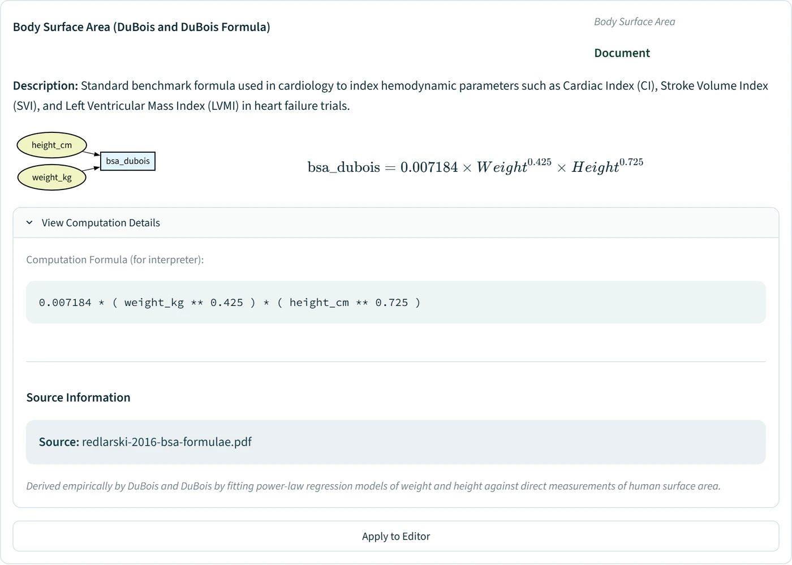

# Data Enrichment

The **Data Enrichment** page handles the complete data preparation pipeline — from importing external data sources and imputing missing values, to creating new variables from formulas (typed with the help of the editor, or suggested by the AI engine from the columns of your dataset) and through transformations, dimensionality reduction, and clustering. All transformations are logged to the trace system and can be replayed.

## The Enrich draft

Changes made on this page — merges, derived variables, transformations, imputations — go into a **draft**. A banner at
the top of the page lists them; **Apply to the dataset** makes each one a step of the trace and the analyses use them,
**Discard the draft** forgets them. The main dataset is the one loaded from Data > Import or the sidebar.

A draft can only be applied over the data it was built on. If the data change while it is open (a rename on
Explore, a date conversion on Validate), the banner offers to **redo** the changes on the current data from their
recorded settings, or to discard the draft. An imputation, statistical or by a formula, is computed on, and fills, the
rows of the **analysis population** only (the ticked inclusion and exclusion criteria; every row when none is ticked).
If the population changes before the draft is applied, the banner offers to refit each imputation of the draft on
the new population, and the step then records the rows and the values of the refit. When an applied imputation was
computed on other rows than the current population (on every row, before a criterion was ticked), the analysis pages
say so: for a formula of each row's own values, only when the population gained rows that it left missing.

---

## Import External Data

Merge additional data sources into your main dataset.

### Workflow

1. **Main Dataset** — The current dataset, with the changes of the Enrich draft (load another dataset from Data > Import or the sidebar).
2. **Upload Enrichment Dataset** — Provide the supplementary data to merge.
3. **Select Columns** — Choose which columns to retain from each dataset.
4. **Configure Merge** — Select the join key(s) and merge type (inner, left, right, outer).
5. **Review Results** — Inspect the enriched dataset, including column overlap and row counts.

The enrichment file is read like an imported file, whether it is uploaded or given by its path: the delimiter, the
decimal comma, the encoding and the missing-value tokens ("-", "?", "NA", ...) are detected the same way. For a
text file, **How the file is read** shows the detected delimiter and decimal separator, and lets you choose others
(space, or any single character under "other…"). It opens by itself when only one column is found. The step
records how the file was read (the delimiter, the sheet chosen, the sheets merged and their key), and the replay
reads it again the same way. Date keys are matched as dates when the main dataset holds dates. A workbook given by its path
is read from its first sheet; upload it to choose another one.

---

## Handle Missing Data

Work in this order:

| The missing value | Approach | Tab |
| --- | --- | --- |
| belongs to a variable computed from others: a BMI, a total from its items, a unit conversion | **Declare it** with its formula: the formula is checked against your data | Derived variables |
| is determined by other variables: a weight from the BMI and the height, a total from its parts, a unit conversion | **Exact imputation** by a formula, with *Exact formula* ticked: nothing is estimated | Targeted Imputation |
| is only needed to draw, reduce or cluster the data | **Single imputation**: mean or median, KNN, chained equations, missForest | Global Imputation |
| enters an estimate, a test or a model | **Multiple imputation**, pooled with Rubin's rules | Multiple imputation (for inference) |

Impute exactly first: the values an exact formula fills are then observed data for the statistical imputations, which
have fewer cells to estimate and more information to estimate them from.

### Derived variables

Optional. Declare the variables your data compute from others in the same row: a BMI from the weight and the height,
a total from its items, a unit conversion. With no definition, nothing changes.

**Add a definition**: choose the variable, write its formula in the language of **Create New Variables**, and say,
if you wish, what kind of definition it is and its source (the reference, the units it assumes). Before you add it,
the formula is checked against your data, on this machine: it is computed on the rows where the variable and every
variable of its formula are recorded, and compared with the recorded value.

- Within the precision the variable is recorded with (±0.05 for a BMI recorded to 0.1) when nine rows in ten agree
  within it: the variable was then computed from the recorded values, and the other rows disagree. Otherwise within
  what rounding the formula's variables moves it.
- **Agrees**: 99% of these rows give the recorded value, beyond chance. **Mostly agrees**: 90%. **Disagrees**:
  fewer, or one group of a text or code variable disagrees (a factor wrong for women only). **Too few rows to check**:
  under 60 rows, or the variable takes one value nearly everywhere. A definition the data mostly agree with, or cannot
  check, is used only once you tick *Use it all the same*; one the data disagree with is never used.
- When a constant factor explains the disagreement (10,000 for a height in cm instead of m, 88.4 for a creatinine in
  mg/dL instead of µmol/L), the check says so. The rows that disagree can be shown: often entry errors, which a
  criterion on Data > Validate can exclude from the analysis population. They are shown, never saved.
- Agreeing with your data says nothing of the published reference: name it in the source.

**Find them with the AI engine** (with the engine running, Settings > AI engine): one request for the whole dataset.
The engine is sent the names of your columns, how each is stored, their units in the variable map and, unless you
untick it (for the session), the typical values of each number column to two digits: its 5th, 50th and 95th
percentiles, never the minimum or the maximum, which an outlier would move, and none for a column of fewer than 21
values. No row is sent. It answers with the definitions it recognises, every published
variant and unit version as its own proposal (CKD-EPI 2009 and 2021, a creatinine in mg/dL or µmol/L), with their
inverses. Each proposal is checked here, on your data, and listed with the best evidence first: **Add the N that
agree** adds those the data agree with, and the others are ticked one by one; one the data disagree with is never
added, nor an inverse they disagree with, and a proposal for a variable you declared says it would replace your
definition.

Each definition can have **inverses**: a formula that fills a missing variable of it from the others, a weight from
the BMI and the height. Each inverse is checked like a definition.

**Fill exactly**, below the definitions, computes the missing values they can give, on the analysis population (every
row when no criterion is ticked):
- each variable from its formula, and a variable of a formula from an inverse (a height from the BMI and the weight),
  in the order the definitions depend on each other (a variable's exact formulas first), and again while a fill
  gives another formula a value;
- only where every variable of the formula has a finite value, and a text or code variable takes a value the check
  saw in at least 10 rows; a formula using a text of more than 20 values fills nothing. The values still missing
  afterwards are named, as only an imputation can give them;
- rounded as the variable is written (a BMI to 0.1, an eGFR or a score to the unit), half away from zero as records
  are;
- by a definition the data agree with, or one you accepted; by an inverse only when the data agree with it; never a
  date.

The values count as observed (exact), as with **Exact formula** below, when the data agree with the formula and either
the variable was computed from the recorded values (it agrees within its own rounding), or rounding the formula's
variables moves it by at most the variable's own precision or 5% of its standard deviation (a height from a BMI to
0.1 moves by about 0.2 cm). Otherwise they are single-imputed, which the analyses flag: so are the values of a
definition with a declared tolerance that this bound does not cover, of one you accepted although the data only mostly
agree with it or cannot check it, and a value computed from a single-imputed one. A table lists each fill, with how
its values count, before **Fill N values**. Each fill joins the draft as one step, recorded with the definition it
used (its formula and inverses with their fingerprints, without its source note) and with what its replay must repeat
(the formula computed, the rounding, whether the values count as observed): a replay computes the same values without
reading your current definitions. A draft whose data changed underneath is filled again rather than redone, and
editing or removing a definition after its fill is said on the draft. A definition's check leaves out every imputed
value: a value filled exactly agrees by construction. **Edit** a definition to change its formula, kind
or source: its inverses are kept. Two definitions that would compute each other are refused: declare one as the
other's inverse. The definitions are kept with the study's
criteria: the configuration downloaded from Data > Validate holds them, and uploading it adds those the session does
not have (a variable defined in both keeps the session's definition, which the upload names).

### Targeted Imputation

Impute the missing values of one variable from the variables that determine it. Choose the variable, write the
formula in the same language as **Create New Variables** (a missing weight: `bmi * (height_cm / 100) ** 2`), or take an
AI suggestion, then click **Apply Targeted Imputation**. The formula fills the missing cells only and keeps the
observed values. With criteria ticked in the sidebar, it is computed on the rows of the analysis population and fills
them only, as the global imputation does: an aggregate such as `bmi.mean()` sees no excluded patient, and the excluded
rows keep their missing values. The page names the rows used, and each AI suggestion is tried on them. The step is
traced with the population: a replay evaluates the recorded criteria again and fills the cells of the rows they keep.

Tick **Exact formula** when the other variables determine the value, as for the weight above or a total from its
parts. The values are then imputed exactly. Nothing is estimated, so the analyses and the multiple imputation keep
them as observed values, without the single-imputation warning, and the study dossier lists them as imputed by an
exact formula. Leave it unticked for an approximation or a proxy: the filled cells are then remembered like any single
imputation, the results that use them say so, and the multiple-imputation panel advises imputing the data as they were
before the step (reload a version saved before it, or replay the trace up to the step before it). The choice is
recorded in the trace and kept with saved versions. A formula that uses other rows (a mean, a quantile, a rank, a
shifted value, the value of another row, a test against a column, or dates kept as text, whose order of day and month
is read from the rows) gives estimates: it cannot be exact, and **Apply** refuses it with *Exact formula* ticked, naming
what uses other rows. Convert dates kept as text on Validate first. An exact formula fills only the rows where every
one of its variables has a value (`np.where` would answer a missing one with its "false" branch), the step's
description says how many it left missing, and a value it computes from a single-imputed variable counts as
single-imputed. A formula that handles a missing value itself (`x.fillna(0)`, `np.where(x.isna(), a, b)`) makes an
assumption: apply it with *Exact formula* unticked.

| Feature | Description |
| --- | --- |
| **Formula Editor** | Column names, arithmetic, conditions and the usual functions, as in **Create New Variables**. |
| **AI Imputation Suggestions (RAG)** | With the AI engine on, proposes formulas for the variable from the related columns, each with its reasoning. The engine is told how each column is stored (number, text, date, yes/no; no value is sent). Each formula is tried on your data before you can use it: the option says how many missing values it fills (and how many of them come from a missing input, which a comparison or `np.where` answers as "false"), flags a code that occurs in no row, or says why it cannot be computed (a text column compared with a number, say); **Use Formula #N** puts a formula that computes in the editor. |

#### AI Suggestion Modes

| Mode | Description |
| --- | --- |
| **Free Thinking (Auto)** | Scans all available columns to suggest formulas automatically. |
| **Guided (with Hints)** | User provides a clue (e.g. "unit conversion") and selects context columns; their statistics help the model match units and ranges. |

### Global Imputation

Apply statistical or ML-based strategies to all missing values simultaneously.

| Method | Type | Description |
| --- | --- | --- |
| **Mean / Median** | Statistical | Replace missing values with the column mean or median. |
| **Most Frequent** | Statistical | Replace with the mode (categorical columns). |
| **KNN** | ML | Impute using K-nearest neighbours. |
| **Chained equations** (shown as "MICE") | ML | Single imputation by chained equations (scikit-learn IterativeImputer, one deterministic pass). It is **not** multiple imputation: the uncertainty of the imputation is not propagated to later tests. |
| **MissForest** | ML | Iterative tree-based imputation (missForest algorithm with LightGBM learners) for mixed data types; models are fitted on originally observed rows only. |

#### Global Imputation Options

| Option | Description |
| --- | --- |
| **Categorical Encoder** | Optionally one-hot encode categorical columns during imputation. |
| **Numerical Scaler** | Optionally scale numerical columns during imputation. |
| **Remainder Strategy** | Handle columns not part of the imputation (passthrough, drop). |

After imputation, an **imputation mask** highlights which values were filled, and a **before/after summary** is displayed.

Values filled here are single imputations: fine for exploration, clustering and figures, but the analyses treat them as observed, so their standard errors and p-values are too small. CohortStudio remembers which cells were filled (also in saved versions and replays), and every result that uses them shows a warning.

### Multiple imputation (for inference)

The **Multiple imputation (for inference)** tab creates m completed versions of the analysis population. The analysis pages run each analysis on every version and pool the results with Rubin's rules (chapter 5). The dataset itself is not changed. The panel has five steps.

1. **Population and missingness**: rows, share of incomplete rows, the suggested m (at least the percentage of incomplete rows; White, Royston & Wood 2011) and the missing values of each variable. Values filled earlier by a single imputation are flagged: the multiple imputation would treat them as observed. Values imputed by an exact formula are listed apart, without a warning: they count as observed.
2. **Imputation model**: the variables. Identifiers, dates, free text and categories with more than 20 levels are left out by default. Keep every variable of the planned analyses, the outcome included: leaving it out biases the associations towards zero (Moons et al. 2006). Each incomplete variable gets a method:

   | Method | For | How |
   | --- | --- | --- |
   | `pmm` | numeric | predictive mean matching: a Bayesian regression draw, then an observed value of one of the 5 closest donors (default) |
   | `norm` | numeric | Bayesian linear regression with a random residual |
   | `logreg` | two categories | Bayesian logistic regression, augmented against perfect prediction (White, Daniel & Royston 2010) |
   | `polyreg` | several categories | multinomial logistic regression on a bootstrap sample of the observed rows |
   | `rf` | any | random-forest donors (Doove, van Buuren & Dusseldorp 2014) |
   | *do not impute* | structurally missing values | the variable stays missing and is not used as a predictor (for example a 6-month measurement of a patient who died before 6 months) |

3. **Settings**: m, iterations, seed (the same settings give the same imputations), imputation within the levels of a variable (`by`), a planned Cox model (the event and the Nelson-Aalen cumulative hazard then replace the follow-up time as predictors; White & Royston 2009), and several processor cores. The cores are shared by everyone using the server: a run gets the free ones and never waits, or runs on one core when fewer than two are free (the page says so). The server's total is `CMP_MI_MAX_WORKERS` (default: the cores minus one); the same settings give the same imputations whatever the number of cores.
4. **Diagnostics**: chain traces (mean and SD of each variable per iteration: the chains should mix, without a trend), an indicative R-hat, observed against imputed values, and the predictors left out (constant or collinear).
5. **Use, save, export**: the status of the imputation against the current population (fresh, a union of whole strata, fitted on more rows, or out of date), saving a version with the imputation, mice long and Stata flong files, and a methods paragraph to adapt for the paper (Sterne et al. 2009).

The imputation is recorded in the trace (`mi_impute`, with a fingerprint of the imputed cells); a full replay re-runs it and checks that it finds the same cells.

---

## Create New Variables

The tab derives variables in two ways: **Apply Common Transformations to Multiple Selected Variables** transforms,
reduces or clusters several columns at once (see *Transformation Types* below), and **Variable Computation** computes
one variable from a formula on the existing columns, typed by you or suggested by the AI engine.

### Compute a variable from a formula

Under **Variable Computation**, write the formula with the column names, as in a spreadsheet:
`weight_kg / (height_cm / 100) ** 2`. The editor guides each step:

| Step | What the editor does |
| --- | --- |
| **Name** | Checks the name as you type: it must be new and start with a letter or an underscore. |
| **Formula** | Under **Column Suggestions**, offers the columns whose names come closest to the word you are typing; click one to put it in place. A name with spaces or symbols goes between doubled double quotes: `""Height (m)""`. |
| **Check** | Validates the formula and shows the first rows of the columns it uses (missing values in red) and its constants. |
| **Compute & Preview** | Computes the variable and shows it next to its source columns, with its statistics on the analysis population: N, missing values, median and quartiles, mean and SD. Values more than three interquartile ranges beyond the quartiles are listed with their source values, since an entry error (a height in metres, a weight of 0) moves the mean and the SD. |
| **Confirm & Add Variable to Dataset** | Adds the variable to the Enrich draft. |

The formula language covers arithmetic, comparisons, conditions (`x if condition else y`, `np.where`), the usual
mathematical functions (`np.log`, `np.exp`, `np.sqrt`, `np.minimum`, `np.maximum`, `round`) and the text and date
methods of a column (`sex.str.strip()`, `enrol_date.dt.year`); subtracting two dates gives a number of days. A power
is written `**`: `^` is refused in a new formula, because it is a bitwise exclusive or (`170 ^ 2` gives 168). Anything
else is refused before it runs, whether the formula was typed, loaded from a trace or proposed by the AI engine. The
formula is recorded in the trace, and a replay computes the variable again from it.

### Variables suggested by the AI engine

With the AI engine on, **AI Variable Suggestions (RAG)**, above the editor, proposes variables built from the columns
of your dataset:

| Mode | What it looks for |
| --- | --- |
| **Specific search** | A concept you name (*BSA*, *eGFR*, *cardiovascular risk*), with a strategy: *Go To Target* finds formulas that compute it, *Go From Target* finds scores that use it as an input, *Around Target* finds proxies and surrogates. |
| **Exploratory mode** | The standard indices and scores that the columns of the dataset allow (BMI, Charlson, ...). |

The engine draws on the passages of your indexed documents (Knowledge > Documents) and, unless you untick it, on the
variable map (Knowledge > Variable map) to understand cryptic column names. It maps the inputs of each formula onto
your columns, writing any unit conversion into the formula, then checks every formula: a formula with a syntax error is
dropped, and a variable it cannot find in the dataset is matched again to your columns, or the suggestion is dropped.
Options: the number of suggestions, the variables it may use (with more than 50 columns and no choice, identifiers
and free-text columns are left out), and whether to keep the formulas that need a variable the dataset lacks.

Each suggestion shows its formula in mathematical notation, a small graph of the variables its formula uses (read as
the application computes it: those your dataset lacks are marked missing), what it gives on your data (a value for
how many rows, how many of them from a missing input, or why it cannot be computed), its clinical relevance and its
source: *Document* (the file and pages), *Model Knowledge* or *Hybrid*. For a missing
input, **Find Proxy** and **Find Alternative Formula** look for a substitute among your columns. **Apply to Editor**
copies the name and the formula into the editor, where you check, compute and preview them like a formula of your own;
nothing is added to the dataset until you confirm it. A formula the model writes with `` `a name` `` for a column or
`^` for a power is shown and applied in the application's notation (`""a name""`, `**`).

For example, on the tutorial cohort with a review of the body-surface-area formulae in the library (Redlarski,
Palkowski and Krawczuk, *Sci Rep* 2016, CC BY 4.0), *BSA* with *Go To Target* proposes the Du Bois, Mosteller,
Haycock, Gehan and George, and Mattar formulas, each mapped onto `height_cm` and `weight_kg` and marked *Document*:

Its preview computes it on every row: the 5 values made from entry errors (three heights typed in metres, weights of
0 and 350 kg) lie far outside the others and are listed with their source values.

The suggestions come from the language model and your documents. They are not checked against a terminology or a
formulary. A *Document* suggestion names the file and pages to compare it with. A *Model Knowledge* formula is
recalled by the language model and can be wrong in a way the preview does not show: compare its constants and
exponents with the published reference before you use the variable. In one run, the Gehan and George
body-surface-area formula came back with the exponents of weight and height swapped, about 9 % too high for an
adult. The preview catches errors of units and of entry, such as a height typed in metres.

### Transformation Types

#### Dimensionality Reduction

| Method | Description |
| --- | --- |
| **PCA** | Principal Component Analysis (via Prince) of the standardised numeric columns. |
| **FAMD** | Factor Analysis of Mixed Data: numeric columns as quantitative variables, other columns as categories, as in FactoMineR. |
| **t-SNE** | Non-linear embedding for 2-D/3-D visualisation. Parameters: perplexity, learning rate. |
| **UMAP** | Uniform Manifold Approximation. Parameters: n_neighbours, min_dist. |

For PCA and FAMD, the column list leaves out the columns these methods cannot use, and a caption says why:
- dates (convert one to a number first, e.g. the days since a reference date);
- text with mostly distinct values (identifiers, free text), which would add one dimension per value;
- columns holding a single value.

A coded category stored as numbers (1, 2, 3) is analysed as a number: convert it to text to analyse it as
categories.

**Show Explained Variance** plots the cumulative percentage of the variance against the number of components. The
curve covers every dimension of the data, so it reaches 100%. A PCA has one dimension per column; a FAMD has one per
numeric column, and per categorical column its categories minus one. Above 50 dimensions, the curve shows the first
50 and says so. The table below gives each variable's correlation with a PCA component, or its share of a FAMD
component.

#### Clustering

| Method | Description |
| --- | --- |
| **K-Means** | Partition-based clustering. Set number of clusters (K). |
| **DBSCAN** | Density-based clustering. Set epsilon and min_samples. |
| **Gaussian Mixture** | Probabilistic clustering. Set number of components. |

> **Note**: Input variables are automatically standardised (Z-score). Dimensionality reduction and clustering need complete data: if a selected column has a missing value, Enrich stops and asks you to impute it first (Handle Missing Data).

#### Encoding

| Method | Description |
| --- | --- |
| **One-Hot** | Binary column per category. |
| **Label** | Integer encoding. |
| **Ordinal** | User-specified order mapping. |

#### Scaling

| Method | Description |
| --- | --- |
| **Z-Score Standardization** | Mean = 0, Std = 1. |
| **Min-Max Normalization** | Scaled to [0, 1]. |
| **Natural Logarithm Transformation** | log(x + 1). |

#### Statistics

Mean, Median, Summation, Minimum Value, Maximum Value or Standard Deviation of a selected column, stored as a new
column that repeats the value on every row.

### Naming Convention

All new columns follow a configurable naming pattern (e.g. `{method_applied}_{initial_variable}`) to maintain traceability.
A name already in the table gets the first free suffix (`age_Z-Score_Standardization_1`), and the replay of the
trace gives the same names. The stochastic methods (PCA, t-SNE, UMAP, FAMD, the clustering methods) are seeded, so
their replay gives the same values.

---

## Dataset Versioning & Persistence

- **Saved versions** — The sidebar dataset card: **Save** stores the current dataset as a new version, **Change** loads a saved one.
- **Automatic Snapshots** — Each merge, transformation and imputation saves a Parquet snapshot in your workspace; the Fast replay mode uses them. A snapshot is kept when its change is applied and reaches the trace. Discarding the draft, redoing it on newer data, loading another dataset or clearing the dataset while it is pending, or signing out deletes the snapshots of its changes, as does a change that changes nothing; a snapshot that a saved trace names is never deleted. A draft still pending when the session ends without signing out (a closed tab, a server restart) keeps its snapshots, and copies left by earlier versions of CohortStudio stay until they are deleted by hand.
- **Reproduce Analysis** — On Reproduce > Versions & traces, upload or select a trace file to replay it or download its Word report.

---

## Practical Guidance
- Impute exactly before you impute statistically: fill with **Targeted Imputation** and *Exact formula* what other variables determine (e.g. a missing weight from the BMI and the height), then run **Global** or **Multiple** imputation on what is left.
- Run **Global Imputation** before **Dimensionality Reduction** or **Clustering** — these methods require complete data.
- Compute indices and scores (BMI, eGFR) under **Variable Computation**. With the AI engine on, start from **AI Variable Suggestions** and read the preview statistics before you confirm.
- Check the **imputation mask** after global imputation to verify which values were filled.
