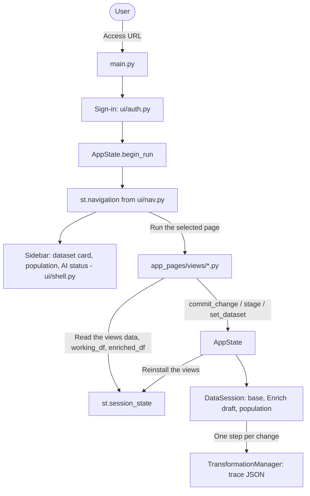
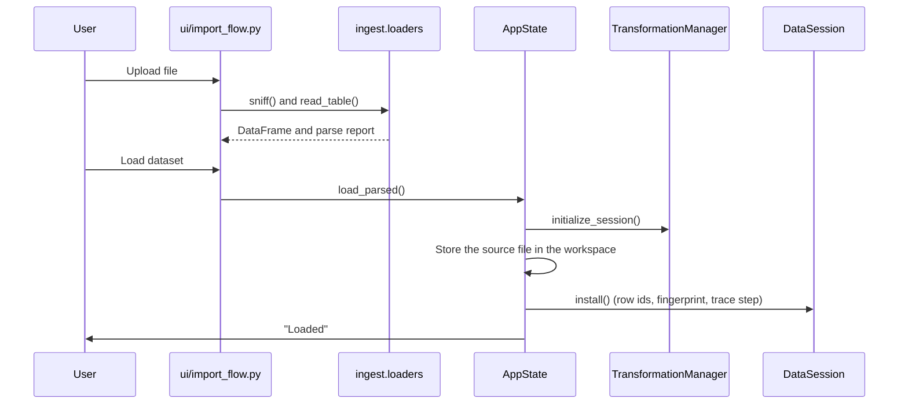

# Process Flow & Architecture

This document outlines the high-level execution flow and data movement within CohortStudio.

## 1. High-Level Architecture

The application is built on **Streamlit**. `AppState` (`ui/state.py`) is the only writer of the session data; it
keeps it in a `DataSession` (`core/session.py`) and installs views of it in `st.session_state` at the start of
every run (changing a view in place changes nothing).

## 2. Data Loading & Initialization Flow

The data loading process sets up the trace and the dataset used throughout the app.

**Files**: `ui/import_flow.py` -> `render_import_flow()`, `ingest/loaders.py`, `ui/state.py` -> `AppState.load_parsed()`

1. **Choose a file**: the user uploads a file (CSV/TSV/TXT, Excel or Parquet) on **Data > Import**.
2. **Check how the file is read**: `sniff()` detects the encoding, delimiter and decimal separator, which the user can
   override (`ui/components/csv_options.py`: the usual delimiters, space, or any single character);
   `separator_problem()` refuses a delimiter that cannot separate columns; `read_table()` parses the file and reports
   malformed lines and empty columns.
3. **Name and load**: `AppState.load_parsed()` calls `set_dataset()`:
    * A new trace session is started (`TransformationManager.initialize_session()`).
    * The source file is stored in the user's workspace (`<DATA_ROOT>/users/<username>/traces/artifacts/<session>/`).
    * `DataSession.install()` adds row ids and a fingerprint and records the load as a trace step.
4. **Version**: by default, the table is also saved as a Parquet version in the workspace.

## 3. Key Feature Flows

### 3.1 Data Enrichment Flow

**File**: `app_pages/data_enrichment.py` (page **Data > Enrich**)

Allows users to merge external data or create new variables using formulas.

1. **Configuration**: User selects enrichment file or defines formula.
2. **Processing**:
    * **Enrichment**: `configure_enrichment` merges dataframes.
    * **Formula**: `evaluate_formula_safely` computes new columns using `pandas` and `numpy`.
3. **Persistence**:
    * Snapshot saved to the user's workspace.
    * The result goes into the Enrich draft (`AppState.stage()`).
    * Applying the draft (`AppState.commit_staging()`) traces each change as one step. It is refused when the dataset
      changed after the draft was started, or when the population used by an imputation in it changed.

### 3.2 Data Monitoring (Outlier Detection)

**File**: `app_pages/data_monitoring.py` (page **Data > Validate**, tab *Handle Outliers*)

Detects and handles outliers using user-selected methods.

1. **Selection**: User selects columns and detection method (Z-Score, IQR, LOF, etc.).
2. **Detection**: `OutlierHandler` class runs the algorithm.
    * `detect_outliers_zscore()`
    * `detect_outliers_iqr()`
    * `detect_dbscan_outliers()`
3. **Handling**: User chooses a strategy (remove, clip, tag).
4. **Update**:
    * Remove or tag: **Exclude these N outlier rows from the analysis population** makes the flagged rows a criterion
      of the `outliers` family (row ids frozen), ticked in the sidebar. They are excluded from the analysis
      population; no row is deleted.
    * Clip: **Clip the values of N column(s) in the dataset** clips the values to the method's bounds as one traced
      step (`AppState.commit_change()`).

### 3.3 Variable map (Knowledge Graph)

**File**: `app_pages/data_insight.py` (page **Knowledge > Variable map**)

Visualizes relationships between variables using a Knowledge Graph.

1. **Load Taxonomy**: `get_taxonomy_versions()` lists the saved versions; `load_and_repair_taxonomy()` loads one.
2. **Repair**: `repair_taxonomy_links()` re-links the variables to the formulas that use or produce them.
3. **Graph Construction**: `graph.builders.taxonomy.build_taxonomy_graph()` maps variables, formulas and categories to
   nodes and edges.
4. **Rendering**: `ui.graph_view.render_graph()` renders the interactive graph with the selected engine (Plotly by default).

### 3.4 Documents (RAG Workflow)

**Files**: `app_pages/document_insight.py` (page **Knowledge > Documents**), `manage/rag_manager.py`,
`manage/rag_documents.py`

Implements Retrieval-Augmented Generation to query scientific documents.

1. **Ingestion**: User adds PDFs to the document library (Settings > AI engine).
2. **Indexing**: `RAGManager.initialize_system()` (**Initialise / reindex**):
    * Extracts text (`PDFDocumentLoader`).
    * Chunks text.
    * Generates embeddings with the chosen provider (local Ollama by default).
    * Stores the vectors in the vector database (`manage/vectorstores/`): LanceDB or embedded Qdrant in the user's
      workspace, or a Qdrant server (one collection per user, named at random; each chunk names its PDF, never its
      path, and a server outside the private network needs the session's confirmation).
3. **Retrieval**: the `DocumentIndex` finds relevant chunks (`similarity_search()`, or an MMR retriever filtered by
   document, as in `chat_with_specific_doc()`).
4. **Generation**: the chat model of the chosen provider answers from the retrieved chunks. The knowledge graph,
   summaries and formulas come from `extract_merged_graph_from_docs()`; the dataset coverage from
   `match_columns_to_graph()`.

### 3.5 Traceability & Reproduction

**Files**: `manage/transformation_manager.py`, `manage/trace_documenter.py`, `manage/reproduction_manager.py`,
`app_pages/reproduce_analysis.py`

Ensures all user actions are recorded and reproducible.

1. **Recording**: every change of the data goes through `AppState` and `DataSession`, which call
   `TransformationManager.add_step()` once per change, with what it did to the table.
2. **Persistence**: Steps are saved to a JSON trace file in the user's workspace (`<DATA_ROOT>/users/<username>/traces/`).
3. **Documentation**: `TraceDocumenter` converts the JSON trace into a readable Word report (`.docx`).
4. **Reproduction**:
    * User selects or uploads a trace on **Reproduce > Versions & traces**.
    * `run_trace()` replays the steps from the source file (Full replay) and checks each against its recorded
      fingerprint; Fast replay loads the snapshot saved with a step.

## 4. Function Dependency Graph

A simplified view of how key modules interact.

* **`main.py`**
  * depends on `ui.auth` (sign-in), `ui.nav` (navigation), `ui.shell` (sidebar) and `ui.state` (`AppState`)
  * runs the page files of `app_pages/views/`

* **`app_pages.*`**
  * depend on `ui.state` (`AppState`: data changes and traceability)
  * depend on `manage.db_manager` (Persistence)
  * depend on `ingest.analyzer` (Column typing)
  * depend on `utils.visualization_utils` (Plotting)

* **`ui.state` / `core.session`**
  * `AppState` depends on `core.session.DataSession` and `manage.transformation_manager`
  * `DataSession` depends on `core.population` and `core.fingerprint` (no Streamlit)

* **`manage.*`**
  * `TransformationManager` depends on `pandas`, `json`
  * `DBManager` depends on `duckdb`, `pandas`
